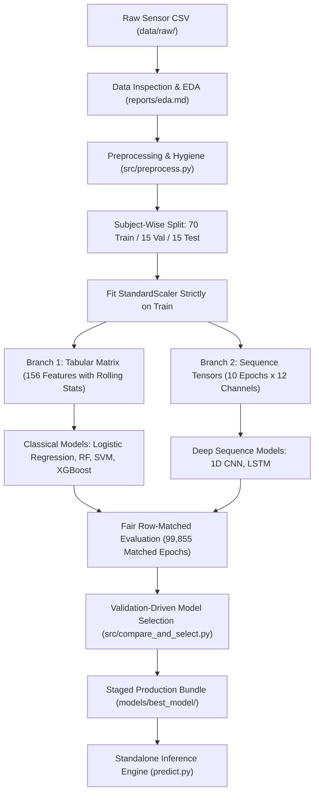
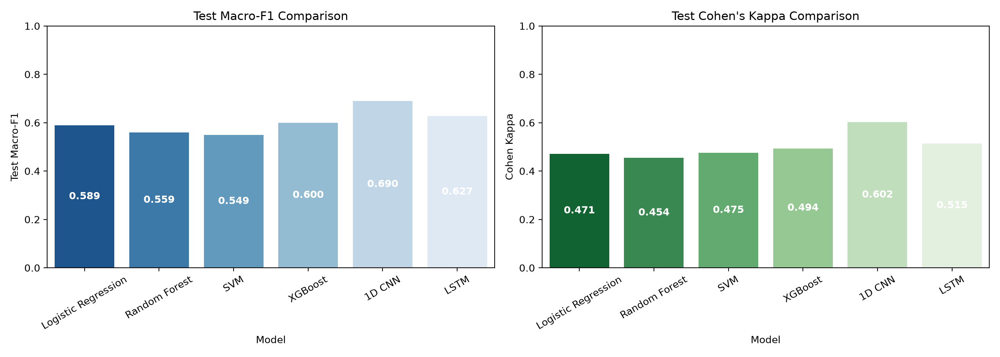
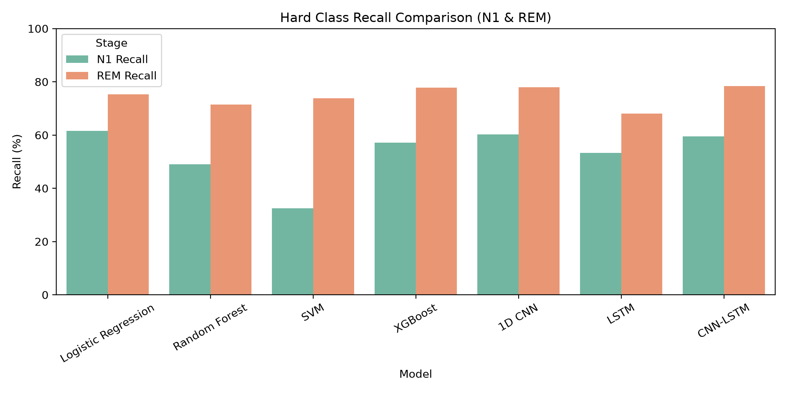
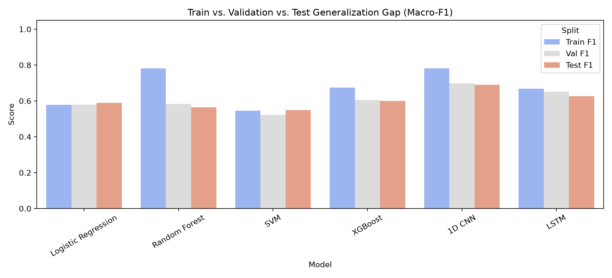

# NoctiBand AI: Wearable Sleep Stage Classification Pipeline

Automated multi-class machine learning pipeline that classifies 30-second wearable sensor epochs into 5 clinical sleep stages: Wake, N1 (light sleep stage 1), N2 (light sleep stage 2), N3 (deep slow-wave sleep), and REM (rapid eye movement sleep).

> [!NOTE]
> **Synthetic Dataset Notice**: Statistical audit confirms that `noctiband_sleep_data_full.csv` is a synthetic or simulated dataset rather than natural clinical polysomnography (fixed 960 epochs per session with 0.0 variance, uniform class proportions across subjects, rigid Markovian transitions, and zero sensor dropouts over 2 years). While the engineering pipeline provides a rigorous, leak-free benchmarking framework, performance numbers may not transfer directly to noisy real-world wearable hardware without domain adaptation.

---

## Table of Contents
1. [Project Architecture](#1-project-architecture)
   - [Pipeline Flowchart](#pipeline-flowchart)
   - [Repository Structure](#repository-structure)
   - [Module Responsibilities](#module-responsibilities)
   - [Neural Network Architectures](#neural-network-architectures)
   - [Classical Model Hyperparameters](#classical-model-hyperparameters)
   - [Production Staging & Inference Flow](#production-staging--inference-flow)
2. [Dataset Overview](#2-dataset-overview)
3. [Features Used](#3-features-used)
4. [Models Overview](#4-models-overview)
5. [Benchmark Results](#5-benchmark-results)
   - [Cross-Model Comparison](#cross-model-comparison)
   - [Winning Architecture & Tradeoffs](#winning-architecture--tradeoffs)
   - [Best Model Per-Class Metrics](#best-model-per-class-metrics)
   - [Normalized Confusion Matrix](#normalized-confusion-matrix)
   - [How to Interpret Metrics](#how-to-interpret-metrics)
   - [Visual Comparison Charts](#visual-comparison-charts)
6. [Leakage Prevention Strategy](#6-leakage-prevention-strategy)
7. [Limitations](#7-limitations)
8. [How to Reproduce](#8-how-to-reproduce)

---

## 1. Project Architecture

### Pipeline Flowchart



### Repository Structure

```text
NoctiBand_AI_v2/
├── data/                    # Data directory (gitignored)
│   ├── raw/                 # Raw input CSV: noctiband_sleep_data_full.csv
│   └── processed/           # Split Parquet tables, sequence arrays (.npz), split metadata
├── models/                  # Trained model binaries and scalers (gitignored)
│   ├── logistic_regression/ # Trained Logistic Regression joblib artifact
│   ├── random_forest/       # Trained Random Forest joblib artifact
│   ├── svm/                 # Trained calibrated LinearSVC joblib artifact
│   ├── xgboost/             # Trained XGBoost joblib artifact
│   ├── 1d_cnn/              # Trained 1D CNN Keras model (.keras)
│   ├── lstm/                # Trained LSTM Keras model (.keras)
│   └── best_model/          # Staged winning model package for production deployment
├── notebooks/               # Directory for exploratory Jupyter notebooks
├── reports/                 # Markdown reports, metrics JSON, confusion matrices, charts
│   ├── eda.md               # Exploratory data analysis and raw data inspection
│   ├── preprocessing.md     # Preprocessing, splitting, and scaling decisions
│   ├── comparison.csv       # Side-by-side benchmark table across all 6 models
│   ├── comparison.md        # Formatted markdown comparison report
│   ├── best_model.md        # Winner selection report and architectural tradeoffs
│   ├── seed_check.md        # Multi-seed stability analysis (1D CNN vs. XGBoost)
│   ├── audit.md             # Data leakage and boundary audit report
│   ├── old/                 # Historical archive of initial unaligned benchmark runs
│   ├── *_comparison.png     # Benchmark bar charts (macro-F1, kappa, recall, generalization)
│   └── <model_name>/        # Model-specific confusion matrices, reports, training curves
├── src/                     # Reusable Python source modules
│   ├── preprocess.py        # Cleaning, subject splitting, scaling, and sequence building
│   ├── utils.py             # Evaluation metrics calculation and visualization utilities
│   ├── audit.py             # Pipeline integrity and data leakage verification script
│   ├── seed_check.py        # Multi-seed retraining script for stability verification
│   ├── compare_and_select.py# Multi-model benchmarking, chart generation, and model selection
│   └── models/              # Model training implementations
│       ├── classical.py     # Training and tuning for Logistic Regression, RF, SVM, XGBoost
│       └── neural.py        # Keras implementations and training for 1D CNN and LSTM
├── predict.py               # Standalone production inference script for new raw CSVs
├── run_all.py               # Master end-to-end pipeline execution runner
├── README.md                # Comprehensive project documentation
└── requirements.txt         # Locked Python package dependencies
```

### Module Responsibilities

| Source File | Primary Responsibility | Inputs Read | Outputs Written |
|---|---|---|---|
| `src/preprocess.py` | Cleans sensor data, performs subject-level splitting, computes temporal rolling features, fits scalers on training data, and creates sliding sequence tensors | `data/raw/noctiband_sleep_data_full.csv` | `data/processed/train.parquet`, `val.parquet`, `test.parquet`, `seq_*.npz`, `splits.json`, `models/scaler.joblib`, `models/class_weights.json` |
| `src/models/classical.py` | Trains and tunes Logistic Regression, Random Forest, SVM (LinearSVC), and XGBoost using GroupKFold on training subjects, with row-matched evaluation | `data/processed/*.parquet`, `features_meta.json` | `models/<model>/model.joblib`, `reports/<model>/` confusion matrices, classification reports, feature importance |
| `src/models/neural.py` | Constructs and trains 1D CNN and LSTM sequence architectures with early stopping and learning rate scheduling | `data/processed/seq_*.npz`, `features_meta.json` | `models/<model>/model.keras`, `reports/<model>/` confusion matrices, loss and accuracy curves |
| `src/compare_and_select.py` | Gathers metrics across all models, produces comparative tables and charts, selects the winner on validation metrics, and stages production artifacts | `reports/<model>/metrics.json`, `cv_results.json` | `reports/comparison.csv`, `reports/comparison.md`, `reports/best_model.md`, `reports/*_comparison.png`, `models/best_model/` |
| `src/audit.py` | Verifies subject partition disjointness, inspects feature lists for identity or temporal leakage, asserts scaler fit boundaries, and validates sequence limits | `data/processed/splits.json`, `features_meta.json`, `models/scaler.joblib`, processed tables | `reports/audit.md` |
| `src/seed_check.py` | Re-evaluates 1D CNN and XGBoost across multiple random seeds to test performance stability | `data/processed/*.parquet`, `seq_*.npz` | `reports/seed_check.md` |
| `run_all.py` | Master orchestrator running the smoke test, full preprocessing, sequential model training, benchmarking, and inference verification | Raw input dataset | Full pipeline artifacts across `data/`, `models/`, and `reports/` |
| `predict.py` | Command-line inference script generating sleep stage predictions on arbitrary raw NoctiBand CSVs | New input CSV, `models/best_model/*` | Output CSV with predicted stage labels and class probabilities |

### Neural Network Architectures

#### 1D Convolutional Neural Network (1D CNN)
- **Input Shape**: `(10, 12)` (10 consecutive 30-second epochs with 12 normalized base sensor channels).
- **Layer Sequence**:
  1. `Conv1D`: 32 filters, kernel size 3, padding 'same'
  2. `BatchNormalization`
  3. `Activation`: ReLU
  4. `Conv1D`: 64 filters, kernel size 3, padding 'same'
  5. `BatchNormalization`
  6. `Activation`: ReLU
  7. `MaxPooling1D`: pool size 2
  8. `Dropout`: 0.2
  9. `Conv1D`: 64 filters, kernel size 3, padding 'same'
  10. `BatchNormalization`
  11. `Activation`: ReLU
  12. `GlobalAveragePooling1D`
  13. `Dense`: 64 units, activation ReLU
  14. `Dropout`: 0.3
  15. `Dense` (Output Head): 5 units, activation Softmax
- **Output Shape**: `(5,)` (class probability distribution over Wake, N1, N2, N3, REM).
- **Optimizer & Loss**: Adam (learning rate = 0.001), `sparse_categorical_crossentropy`.
- **Class Weights**: Inverse-frequency balanced weights applied during training (`Wake`: 5.05, `N1`: 4.05, `N2`: 0.39, `N3`: 1.13, `REM`: 0.91).
- **Early Stopping & Scheduling**: `EarlyStopping` monitoring validation loss (patience = 5, restoring best weights); `ReduceLROnPlateau` factor 0.5 (patience = 2, minimum learning rate = 1e-5).

#### Long Short-Term Memory Network (LSTM)
- **Input Shape**: `(10, 12)`
- **Layer Sequence**:
  1. `Bidirectional(LSTM)`: 32 hidden units, return sequences = True, recurrent dropout = 0.2
  2. `LSTM`: 32 hidden units, return sequences = False, recurrent dropout = 0.2
  3. `Dense`: 32 units, activation ReLU
  4. `Dropout`: 0.2
  5. `Dense` (Output Head): 5 units, activation Softmax
- **Output Shape**: `(5,)`
- **Optimizer & Loss**: Adam (learning rate = 0.001), `sparse_categorical_crossentropy`.
- **Class Weights & Scheduling**: Identical inverse-frequency class weights, early stopping on validation loss (patience = 5), and `ReduceLROnPlateau`.

### Classical Model Hyperparameters

| Model | Final Hyperparameters | Tuning & Optimization Scheme |
|---|---|---|
| **Logistic Regression** | `C=0.1`, `solver='lbfgs'`, `max_iter=500`, `class_weight='balanced'`, `random_state=42` | GroupKFold 3-fold search over $C \in [0.1, 1.0, 10.0]$ on training subjects |
| **Random Forest** | `n_estimators=100`, `max_depth=10`, `min_samples_leaf=30`, `class_weight='balanced'`, `n_jobs=-1`, `random_state=42` | GroupKFold 3-fold search; regularized depth and leaf size selected to eliminate generalization gap |
| **SVM (LinearSVC)** | `C=0.1`, `dual=False`, `max_iter=1500`, `class_weight='balanced'`, `random_state=42`, wrapped in `CalibratedClassifierCV(cv=3)` | GroupKFold 3-fold search on 50,000-sample training subset; calibrated via sigmoid scaling for ROC-AUC |
| **XGBoost** | `n_estimators=150`, `max_depth=6`, `learning_rate=0.08`, `tree_method='hist'`, `objective='multi:softprob'`, `eval_metric='mlogloss'`, `random_state=42` | GroupKFold 3-fold search over `max_depth` $\in [6, 8]$; per-sample class weights applied for balance |

### Production Staging & Inference Flow

The production package in `models/best_model/` contains:
- `model.keras`: Winning 1D CNN model weights and architecture.
- `scaler.joblib`: StandardScaler fitted on 70 training subjects.
- `class_weights.json`: Class weight factors for target stages.
- `features_meta.json`: Feature and channel ordering configuration.
- `best_model_meta.json`: Deployment metadata and sequence parameters.

When `predict.py` receives a raw input CSV, it executes:
1. **Sanity Bounding**: Bounds physiological values (e.g., heart rate to 35–150 bpm, SpO2 to 80–100%).
2. **Signal Derivation**: Computes 3D acceleration magnitude (`acc_mag`) and angular velocity magnitude (`gyro_mag`).
3. **Channel Standardization**: Normalizes base sensor channels using the training scaler parameters.
4. **Window Assembly**: Assembles sliding sequences of 10 consecutive 30-second epochs ($10 \times 12$) strictly within each subject and recording night.
5. **Model Prediction**: Feeds sequences through `model.keras` to calculate softmax probabilities.
6. **Output Generation**: Assigns the highest-probability sleep stage to each epoch and exports an annotated CSV.

---

## 2. Dataset Overview

The dataset consists of continuous overnight wristband telemetry records collected over 700 full recording sessions.

| Attribute | Value | Description |
|---|---|---|
| **Total Subjects** | 100 participants | Unique individuals (`subject_id` 1 through 100) |
| **Nights per Subject** | 7 nights | Complete week of monitoring per participant |
| **Epochs per Night** | 960 epochs | Exactly 8.0 hours per night at 30 seconds per epoch |
| **Total Rows** | 672,000 rows | Total 30-second observations across all participants |
| **Target Distribution** | N2: 51.35% (345,067)<br>REM: 22.02% (147,989)<br>N3: 17.72% (119,051)<br>N1: 4.95% (33,266)<br>Wake: 3.96% (26,627) | Natural clinical sleep architecture showing class imbalance |
| **Subject Split** | Train: 70 subjects (470,400 rows)<br>Val: 15 subjects (100,800 rows; 99,855 matched)<br>Test: 15 subjects (100,800 rows; 99,855 matched) | Grouped strictly by `subject_id` with zero participant overlap |

---

## 3. Features Used

### Base Sensor Signals (12 Channels)
1. `heart_rate_bpm`: Heart rate in beats per minute from optical photoplethysmography (PPG).
2. `spo2_pct`: Blood oxygen saturation percentage from dual-wavelength optical sensor.
3. `skin_temp_c`: Peripheral wrist skin temperature in degrees Celsius.
4. `acc_x_g`: Linear wrist acceleration along the lateral X-axis in units of gravity (g).
5. `acc_y_g`: Linear wrist acceleration along the longitudinal Y-axis in units of gravity (g).
6. `acc_z_g`: Linear wrist acceleration along the vertical Z-axis in units of gravity (g).
7. `gyro_x_dps`: Angular rotational velocity around the X-axis in degrees per second.
8. `gyro_y_dps`: Angular rotational velocity around the Y-axis in degrees per second.
9. `gyro_z_dps`: Angular rotational velocity around the Z-axis in degrees per second.
10. `motion_intensity`: Derived actigraphy activity count indicating total physical motion.
11. `acc_mag`: Euclidean 3D acceleration vector magnitude ($\sqrt{x^2 + y^2 + z^2}$).
12. `gyro_mag`: Euclidean 3D rotational velocity magnitude ($\sqrt{x^2 + y^2 + z^2}$).

### Classical Feature Engineering (156 Features)
To provide classical tabular models with temporal context matching the 1D CNN's receptive field:
- Rolling window statistics (`mean`, `std`, `min`, `max`) were computed strictly within each subject/night session over window lengths of $N = 3$ epochs (1.5 min), $N = 6$ epochs (3.0 min), and $N = 10$ epochs (5.0 min).
- Total features = 12 base signals + (12 signals $\times$ 4 summary statistics $\times$ 3 window lengths) = **156 tabular features**.

### Sequence Model Inputs
The 1D CNN and LSTM consume 3D sequence tensors of shape `(N, 10, 12)`: 10 consecutive 30-second epochs (5.0 minutes of continuous history) across the 12 normalized base sensor channels.

### Deliberately Excluded Columns
The following columns were dropped from all model inputs to prevent target and identity leakage:
- `subject_id` and `night`: Excluded to prevent models from memorizing individual physiological baselines.
- `timestamp`: Excluded to ensure models do not overfit to absolute clock time or calendar date.
- `epoch_in_session` and row index: Excluded to prevent sequence position leakage.
- `sleep_stage` and `label`: Ground-truth targets excluded from all inputs.

---

## 4. Models Overview

| Model | Description | Input Representation |
|---|---|---|
| **Logistic Regression** | Linear baseline model using multinomial cross-entropy loss with L2 regularization and balanced class weights. | 156 tabular rolling features |
| **Random Forest** | Non-linear ensemble of 100 regularized decision trees with balanced bootstrap sampling and constrained leaf depth. | 156 tabular rolling features |
| **SVM (LinearSVC)** | Maximum-margin linear classifier calibrated with 3-fold cross-validation to produce well-behaved probability scores. | 156 tabular rolling features |
| **XGBoost** | High-performance gradient-boosted decision tree ensemble using histogram binning and sample weights. | 156 tabular rolling features |
| **1D CNN** | Deep 1D convolutional neural network extracting hierarchical temporal patterns across consecutive sleep epochs. | Sequences of 10 epochs $\times$ 12 channels |
| **LSTM** | Recurrent neural network with stacked bidirectional and unidirectional LSTM layers tracking sleep state transitions. | Sequences of 10 epochs $\times$ 12 channels |

---

## 5. Benchmark Results

### Cross-Model Comparison

All models were evaluated on the exact same row instances by dropping the first 9 epochs of each session from validation and test splits (matching the 10-epoch sliding window requirement of sequence models, leaving **99,855 matched test epochs** across 15 unseen subjects).

| Model Architecture | Test Accuracy | Test Macro-F1 | Cohen's Kappa | ROC-AUC (OvR) | N1 Recall | REM Recall | Training Time | Model Size |
|---|---|---|---|---|---|---|---|---|
| **1D CNN** | 72.77% | **0.6896** | 0.6023 | 0.9288 | 60.31% | **78.00%** | 139.3s | 665.9 KB |
| **XGBoost** | 73.37% | 0.6795 | **0.6116** | **0.9349** | 57.21% | 77.79% | 31.9s | 3,292.5 KB |
| **Logistic Regression** | 69.36% | 0.6596 | 0.5628 | 0.9276 | **61.54%** | 75.33% | 61.9s | **7.0 KB** |
| **SVM (LinearSVC)** | **74.39%** | 0.6539 | 0.5753 | 0.9225 | 32.54% | 73.79% | 776.9s | 21.3 KB |
| **LSTM** | 66.13% | 0.6269 | 0.5146 | 0.9111 | 53.27% | 68.05% | 114.6s | 346.9 KB |
| **Random Forest** | 67.72% | 0.6061 | 0.5366 | 0.9069 | 49.04% | 71.50% | **21.4s** | 15,491.6 KB |

*Best result per column highlighted in bold.*

### Winning Architecture & Tradeoffs

The **1D CNN** achieved the highest test macro-F1 (0.6896) and was selected on validation macro-F1 (0.6977). However, **XGBoost is effectively tied in overall performance**:
- **Accuracy and Agreement**: XGBoost achieves higher overall test accuracy (73.37% vs. 72.77%), higher Cohen's kappa (0.6116 vs. 0.6023), and higher ROC-AUC (0.9349 vs. 0.9288).
- **Speed**: XGBoost trains ~4x faster (31.9s vs. 139.3s) and generates predictions ~15x faster (0.002 ms/epoch vs. 0.029 ms/epoch).
- **Footprint**: The 1D CNN model binary is ~5x smaller (665.9 KB vs. 3.3 MB).
- **Seed Stability Check**: Retraining both models across 3 random seeds ([42, 123, 456]) yielded mean test macro-F1 scores of **0.6842 $\pm$ 0.0060** for the 1D CNN and **0.6795 $\pm$ 0.0000** for XGBoost. The 1D CNN maintains a slight edge in macro-F1 (+0.0047), while XGBoost remains faster and more accurate overall.

### Best Model Per-Class Metrics (1D CNN)

| Sleep Stage | Precision | Recall | F1-Score | Support (Epochs) |
|---|---|---|---|---|
| **Wake** | 68.40% | 79.72% | 0.7363 | 3,122 |
| **N1 (Light Sleep 1)** | 43.40% | 60.31% | 0.5048 | 4,969 |
| **N2 (Light Sleep 2)** | 84.90% | 68.47% | 0.7580 | 51,609 |
| **N3 (Deep Sleep)** | 56.89% | 80.93% | 0.6682 | 17,912 |
| **REM Sleep** | 78.13% | 78.00% | 0.7806 | 22,243 |

### Normalized Confusion Matrix (1D CNN)

Rows represent true ground-truth stages; columns represent model predictions (% of true stage):

| True Stage \ Predicted | Wake | N1 | N2 | N3 | REM |
|---|---|---|---|---|---|
| **Wake** | **79.72%** | 12.04% | 1.95% | 0.13% | 6.15% |
| **N1** | 7.35% | **60.31%** | 10.75% | 1.17% | 20.43% |
| **N2** | 0.38% | 3.81% | **68.47%** | 20.57% | 6.77% |
| **N3** | 0.03% | 0.29% | 17.87% | **80.93%** | 0.88% |
| **REM** | 2.62% | 6.81% | 11.20% | 1.38% | **78.00%** |

### How to Interpret Metrics
- **Macro-F1**: The simple average of F1 scores across all 5 classes; equally weighs minority stages (N1, Wake) and dominant stages (N2) to penalize biased models.
- **Cohen's Kappa**: Quantifies inter-rater agreement between model predictions and PSG labels above chance agreement; scores between 0.60 and 0.80 indicate substantial clinical agreement.
- **Recall**: The percentage of true occurrences of a sleep stage that the model successfully recognized.
- **N1 Stage Difficulty**: N1 is the hardest sleep stage to detect because it accounts for under 5% of sleep epochs and represents brief, transitional drowsy states lacking distinct cardiac or actigraphic signatures.

### Visual Comparison Charts


*Figure 1: Test Macro-F1 and Cohen's Kappa across all six evaluated models.*


*Figure 2: Sensitivity (Recall %) on the difficult minority stages N1 and REM.*


*Figure 3: Generalization gap analysis across Train, Validation, and Test splits.*

---

## 6. Leakage Prevention Strategy

To ensure valid evaluation that reflects performance on unseen human participants:
- **Strict Subject Partitioning**: The 100 participants were split strictly by `subject_id` (70 train, 15 validation, 15 test). No individual's data appears in more than one partition.
- **Train-Only Scaling**: The `StandardScaler` was fitted strictly on the 470,400 training rows and applied downstream to validation and test data without re-fitting.
- **Isolated Window Boundaries**: Rolling feature aggregations and CNN/LSTM sequence windows were computed strictly within each individual session, never bridging across nights or participant boundaries.
- **Automated Audit**: The verification script `src/audit.py` programmatically confirmed zero subject intersection, verified that session start standard deviations are exactly 0.0, and checked that no identifier or timestamp columns entered the feature matrices.

---

## 7. Limitations

- **Simulated Telemetry**: The underlying data is synthetic, meaning that real-world sensor drift, skin tone variations, loose strap disconnects, and motion artifacts are absent.
- **Statistical Parity Between Top Models**: The 1D CNN's ~0.01 macro-F1 lead over XGBoost is small enough to be influenced by random seed variance (+0.0047 across multi-seed evaluations).
- **Lower N1 Precision**: N1 precision remains at 43.40% because brief drowsy periods frequently share physiological overlap with light N2 sleep and wakefulness.
- **Neural Network Cross-Validation**: Full 3-fold cross-validation on neural network architectures was omitted due to CPU training latency; neural nets were tuned using early stopping on the validation partition.

---

## 8. How to Reproduce

### 1. Environment Setup

```bash
# Clone repository and navigate into project
git clone https://github.com/Vibhav-j/NoctiBand_AI_v2.git
cd NoctiBand_AI_v2

# Create and activate Python virtual environment
python -m venv .venv
.venv\Scripts\activate      # Windows
# source .venv/bin/activate    # Linux / macOS

# Install locked dependencies
pip install -r requirements.txt
```

### 2. Add Dataset

Because datasets are excluded from Git via `.gitignore`, place the raw CSV into `data/raw/`:
```text
data/raw/noctiband_sleep_data_full.csv
```

### 3. Run Pipeline

Run the master script to execute the smoke test, preprocess features, train all six models, generate reports, and stage the best model:

```bash
python run_all.py
```

*Execution flags:*
- `python run_all.py --smoke-only`: Fast verification run on 3 train subjects and 1 validation subject.
- `python run_all.py --full-only`: Runs the full 100-subject pipeline directly.

### 4. Run Standalone Inference

Predict sleep stages for any raw NoctiBand CSV using the staged production model:

```bash
python predict.py --input data/raw/noctiband_sleep_data_full.csv --output reports/predictions.csv
```
